<p align="center">
  <picture>
    <source media="(prefers-color-scheme: dark)" srcset="docs/logo-on-dark.svg">
    
  </picture>
</p>

## A living workspace

Plan, design, build, and review in one workspace. It integrates with your existing coding subscriptions and provides first-class integration with a sophisticated knowledge graph and memory system.

Use it hosted at <a href="https://heyhey.dev">heyhey.dev</a>, or run it locally. The local version uses PostgreSQL and is served to your browser of choice by the `heyhey` CLI.

```sh
npm install -g @hey-hey/cli
heyhey local
```

**Requirements:** Docker, Node 20 or newer, and a Claude, Codex or OpenCode subscription of your own. See [Installation](#installation) for setup on macOS, Windows and Linux.

## Features

<table>
  <tr>
    <td width="50%">
      <h3>Agent Development Environment</h3>
      Agent sessions, a secure relay for mobile devices, custom agent modes (skills backed by the knowledge graph), and integrated review and commit subagents.
    </td>
    <td width="50%">
      <a href="docs/session.png">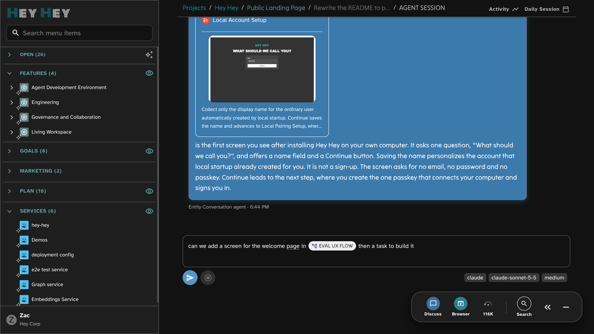</a>
    </td>
  </tr>
  <tr>
    <td width="50%">
      <h3>Product management with multi-tiered memory</h3>
      Agent-assisted knowledge management with a proposal system that leaves you in control. Support for custom types and evals to test your project structure.
    </td>
    <td width="50%">
      <a href="docs/feature-tree.png">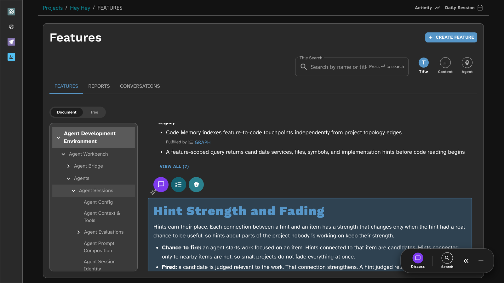</a>
    </td>
  </tr>
  <tr>
    <td width="50%">
      <h3>Human(s) Controlled</h3>
      You retain complete control over the direction and design of your project. All non-code changes are controlled via a proposal system. (Coming soon) customizable rules for approval requirements.
    </td>
    <td width="50%">
      <a href="docs/proposal-with-diff.png">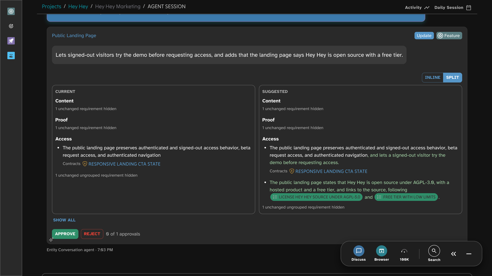</a>
    </td>
  </tr>
</table>

## Your project, connected

Diagrams, design docs, plans, decisions, contracts, and mockups are first-class items, not attachments. Each one links to the features and tasks it affects, and together they form the project's knowledge graph. You can reference them in any session, during planning, task creation, or implementation. Hey Hey helps keep them updated as your project evolves.

<table>
  <tr>
    <td width="33%" valign="top">
      <h3>Diagrams</h3>
      <a href="docs/diagram.png">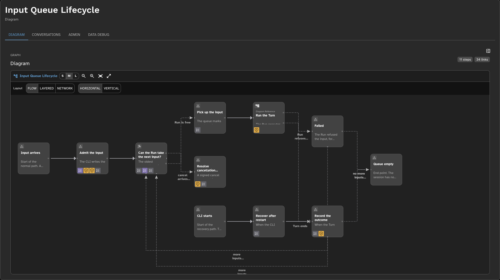</a>
    </td>
    <td width="33%" valign="top">
      <h3>Design docs</h3>
      <a href="docs/design-doc.png">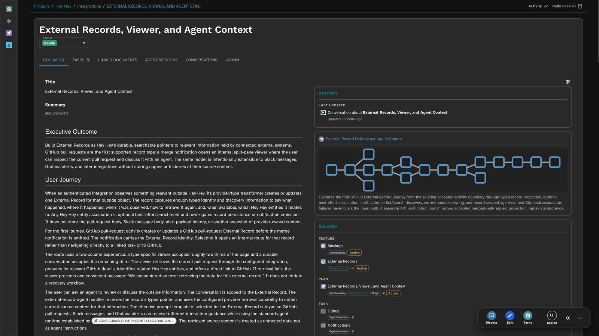</a>
    </td>
    <td width="33%" valign="top">
      <h3>Decisions</h3>
      <a href="docs/decisions.png">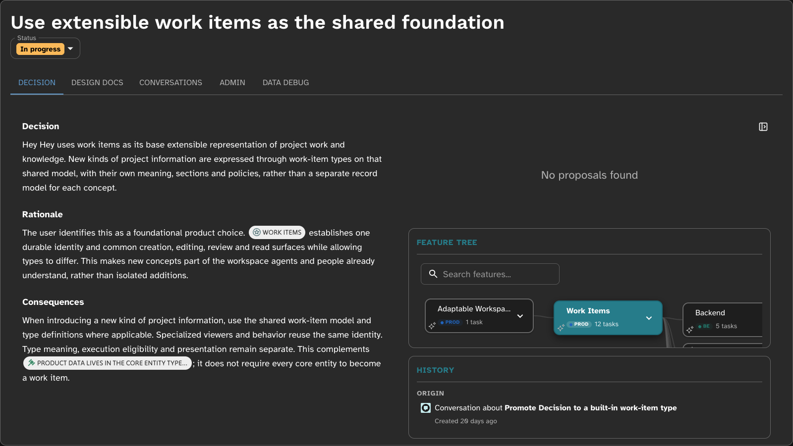</a>
    </td>
  </tr>
  <tr>
    <td colspan="3" align="center">
      <picture>
        <source media="(prefers-color-scheme: dark)" srcset="docs/graph-fill-dark.gif">
        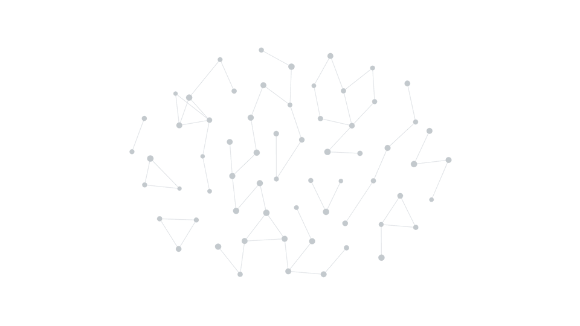
      </picture>
    </td>
  </tr>
  <tr>
    <td width="33%" valign="top">
      <h3>Plans</h3>
      <a href="docs/plans.png">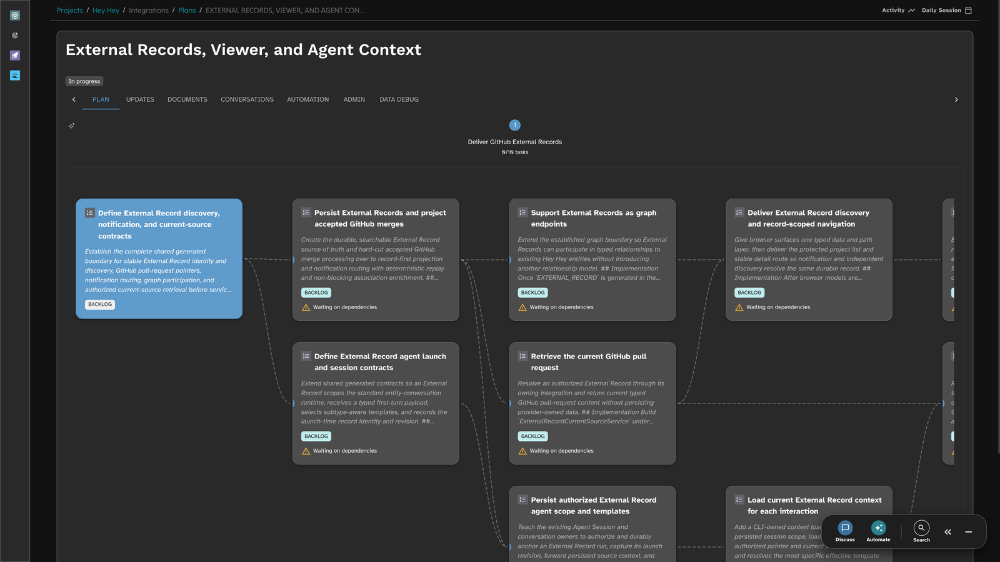</a>
    </td>
    <td width="33%" valign="top">
      <h3>Mockups and UX flows</h3>
      <a href="docs/ux-flow.png">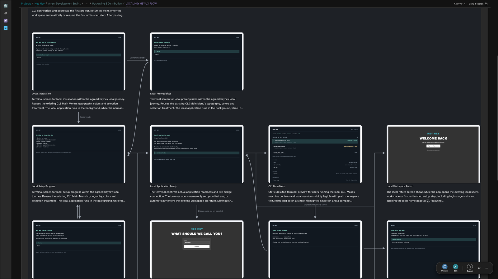</a>
    </td>
    <td width="33%" valign="top">
      <h3>Agent Modes</h3>
      <a href="docs/agent-modes.png">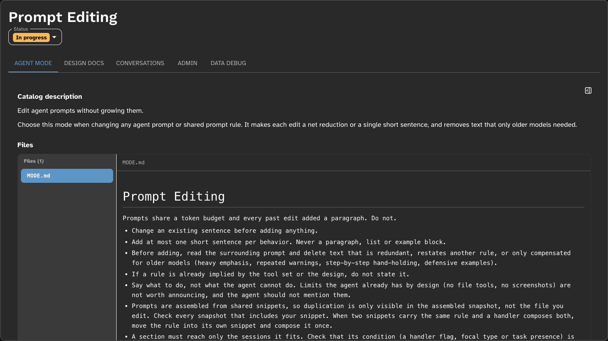</a>
    </td>
  </tr>
</table>

<div align="center">
  <h3>Continue from your phone</h3>
  <p>Pair your devices through a secure relay. With a local install, your phone also needs a route to your computer, for example through Tailscale.</p>
  <a href="docs/mobile.png">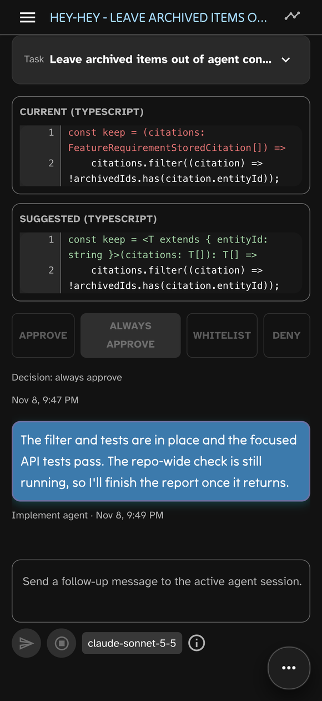</a>
</div>

## Installation

The local version runs on your own computer. Your projects are stored there, and your coding agents use your own Claude, Codex or OpenCode subscription.

### What you need

|                  |                                                                                                  |
| ---------------- | ------------------------------------------------------------------------------------------------ |
| **System**       | macOS, Windows 10 or 11 with WSL 2, or Linux                                                     |
| **Docker**       | Docker Desktop on macOS and Windows; Docker Engine with the Compose plugin on Linux              |
| **Node.js**      | Version 20 or newer, for the `heyhey` CLI                                                        |
| **Coding agent** | Claude Code, Codex or OpenCode, installed and signed in with your subscription                   |
| **Memory**       | About 600 MB while idle. Any computer with 8 GB of memory has plenty of room.                    |
| **Disk**         | About 5 GB for the application, plus your project data                                           |
| **Network**      | Needed for the first install and updates. The search model runs on your computer, without a GPU. |

### 1. Install Docker

Hey Hey runs its services in Docker containers, so they don't change anything else on your computer.

- **macOS:** install [Docker Desktop for Mac](https://docs.docker.com/desktop/setup/install/mac-install/) and open it once. Docker Desktop doesn't always start by itself after a restart; open it before running `heyhey local`, or turn on **Start Docker Desktop when you sign in to your computer** in its settings.
- **Windows:** install [Docker Desktop for Windows](https://docs.docker.com/desktop/setup/install/windows-install/) with the WSL 2 backend, then open it.
- **Linux:** install [Docker Engine](https://docs.docker.com/engine/install/) and the [Compose plugin](https://docs.docker.com/compose/install/linux/), and make sure the Docker service is running.

Check that Docker is ready:

```sh
docker info
```

### 2. Install the CLI

Install [Node.js](https://nodejs.org/) 20 or newer, then:

```sh
npm install -g @hey-hey/cli
```

### 3. Start Hey Hey

```sh
heyhey local
```

The first time, `heyhey local` checks Docker, asks before installing, and then downloads the application and a small search model (about 35 MB). It starts the services and opens Hey Hey in your browser at <http://localhost:5173>. You create your account there; it is separate from any heyhey.dev account.

After that, `heyhey local` reconnects to the running application and offers updates when a new release is out.

### Stopping

```sh
heyhey local stop
```

Stopping keeps your data. Run `heyhey local` to start again.

### What runs on your computer

| Service          | What it does                                    | Memory at idle |
| ---------------- | ----------------------------------------------- | -------------- |
| Web app          | The interface you use in the browser            | about 30 MB    |
| API              | Stores your projects and coordinates everything | about 400 MB   |
| Graph and search | Links your project's items and searches them    | about 60 MB    |
| PostgreSQL       | The database                                    | about 95 MB    |
| Redis            | Live updates and background jobs                | about 10 MB    |

The web app and API are reachable only from your computer, on ports 5173 and 3000.

## License

Hey Hey is open source under [AGPL-3.0](LICENSE). The hosted version at heyhey.dev is in open beta.

## What's here

This repository holds the core of Hey Hey in one checkout. Each part keeps its own README with the details.

| Path                                                 | What it is                                                                                                                    |
| ---------------------------------------------------- | ----------------------------------------------------------------------------------------------------------------------------- |
| [`apps/ui`](apps/ui/README.md)                       | The web app people work in: features, documents, proposals, conversations and live agent sessions.                            |
| [`apps/api`](apps/api/README.md)                     | The one backend. It owns project data and its rules, and coordinates the other services.                                      |
| [`apps/cli`](apps/cli/README.md)                     | `heyhey`, the command-line tool that connects your project to the coding agents you already use.                              |
| [`apps/graph-search`](apps/graph-search/README.md)   | The graph and search service the local install runs: one process that stores and queries the project graph and powers search. |
| [`packages/ui-common`](packages/ui-common/README.md) | Code the web app and CLI share: components, hooks, the API client and translations.                                           |
| [`openapi`](openapi/README.md)                       | The OpenAPI specifications every consumer generates its contracts from.                                                       |

## Getting started

To build from source you need Node 24 (see `.nvmrc`) and pnpm 10.18.1 (`corepack enable` picks up the pinned version).

```sh
pnpm install --frozen-lockfile   # one install for every package
pnpm generate:contracts          # validate the specs, then generate every consumer's contracts
pnpm build                       # UI, then CLI, then API
pnpm check                       # UI type-check and tests, CLI type-check and tests
```

To work on a single part, run its scripts with a filter, for example `pnpm --filter ./apps/ui dev`. The web app compiles UI Common straight from `packages/ui-common`, so edits there reload live.

## Changing the API contract

The specifications in [`openapi`](openapi/README.md) are the single source for the API's server models, the web app's and UI Common's client, and the CLI's clients. After changing a spec, run `pnpm generate:contracts` and commit the spec together with everything it regenerated.

- It validates every spec first and generates nothing if validation fails.
- Each consumer still uses its own generator version and options, so outputs that look alike are not merged.
- If one consumer fails to generate, the others still finish and the failed one keeps its previous files.
- It records which spec content was used in `generated-contracts.json`. `pnpm build` and `pnpm check` refuse to run if the generated files don't match the current specs or a consumer's last generation failed.
- `pnpm generate:check` regenerates and fails if any committed generated file would change. CI runs it on every push.

By default every command uses the `openapi` folder of the checkout you're in, including linked worktrees. To generate from a different copy, set `HEY_HEY_OPENAPI_ROOT` to its `openapi` folder. If that path is wrong, generation stops instead of quietly using another copy.

## Images

The web app and the API ship as two separate images, `ui-service` and `api-service`. Both build from the repository root:

```sh
docker build -f apps/ui/Dockerfile -t hey-hey-ui:local .
docker build -f apps/api/Dockerfile -t hey-hey-api:local .
```

An image build stops before compiling if the committed generated files don't match the specs, the same check `pnpm build` runs. The root `.dockerignore` keeps dependencies, build output, local state and secrets out of both images.

On every pull request and push, CI works out what a change affects and runs only those checks and image builds:

- A change inside one app selects that app.
- A UI Common change also selects every package that depends on it: the web app, and the CLI for as long as it still uses UI Common.
- A spec change, or a change to root workspace, lockfile or build files, selects everything.
- Documentation alone selects nothing.

Run `node scripts/affected-builds.mjs -- <changed files>` to see the selection for any set of paths. Each built image's evidence (source commit, intended image name and digests of its inputs) is attached to the CI run. CI never pushes, releases or deploys. Publishing an image or changing what a deployment runs is a separately reviewed step.

## Dependencies

All packages share one `pnpm-lock.yaml` and one `pnpm-workspace.yaml`. Each package still declares its own dependencies. The workspace file holds the shared rules:

- New package versions are held back for three days before they can be installed.
- Only packages listed there may run install-time native builds.
- React is pinned to a single version so the web app, UI Common and the editor share one copy.

Change a dependency in the package that uses it, then run `pnpm install` at the root. Don't delete and regenerate the lockfile: that silently upgrades everything.
