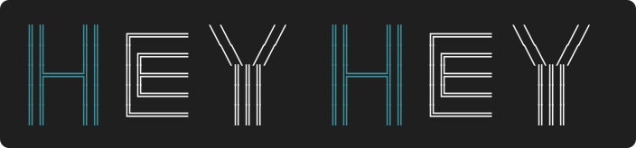

<p align="center">
  
</p>

Hey Hey is a shared place for you and your team to shape a project and build it together. Features, designs, mockups, decisions and tasks live in one workspace and stay connected as the project changes. Coding agents work from the same context you do.

This repository holds the core of Hey Hey in one checkout. Each part keeps its own README with the details.

## What's here

| Path | What it is |
| --- | --- |
| [`apps/ui`](apps/ui/README.md) | The web app people work in: features, documents, proposals, conversations and live agent sessions. |
| [`apps/api`](apps/api/README.md) | The one backend. It owns project data and its rules, and coordinates the other services. |
| [`apps/cli`](apps/cli/README.md) | `heyhey`, the command-line tool that connects your project to the coding agents you already use. |
| [`packages/ui-common`](packages/ui-common/README.md) | Code the web app and CLI share: components, hooks, the API client and translations. |
| [`openapi`](openapi/README.md) | The OpenAPI specifications every consumer generates its contracts from. |

The Graph and Embeddings services live in their own repositories.

## Getting started

You need Node 24 (see `.nvmrc`) and pnpm 10.18.1 (`corepack enable` picks up the pinned version).

```sh
pnpm install --frozen-lockfile   # one install for every package
pnpm generate                    # generate API clients, contracts and the Prisma client
pnpm build                       # UI, then CLI, then API
pnpm check                       # UI type-check and tests, CLI type-check and tests
```

To work on a single part, run its scripts with a filter, for example `pnpm --filter ./apps/ui dev`. The web app compiles UI Common straight from `packages/ui-common`, so edits there reload live.

## Dependencies

All packages share one `pnpm-lock.yaml` and one `pnpm-workspace.yaml`. Each package still declares its own dependencies. The workspace file holds the shared rules:

- New package versions are held back for three days before they can be installed.
- Only packages listed there may run install-time native builds.
- React is pinned to a single version so the web app, UI Common and the editor share one copy.

Change a dependency in the package that uses it, then run `pnpm install` at the root. Don't delete and regenerate the lockfile: that silently upgrades everything.
