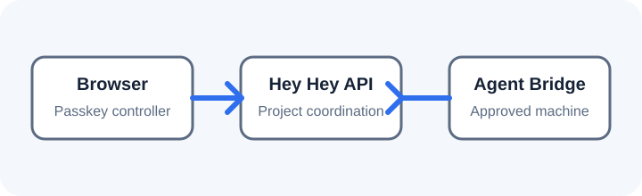

The Agent Bridge is a local CLI process that connects an approved machine to Hey Hey and relays agent work between that machine and the platform. Install Node.js and the `heyhey` CLI, then start enrollment on the exact machine that will run the bridge with `heyhey pair`. The browser creates a native passkey controller, and the CLI shows the claimant and waits for explicit confirmation on that same machine before execution becomes ready. Account sign-in identifies you; the enrolled controller is what authorizes host-affecting work. The bridge can reconnect after a restart, but it does not regain authority from an account session alone.

